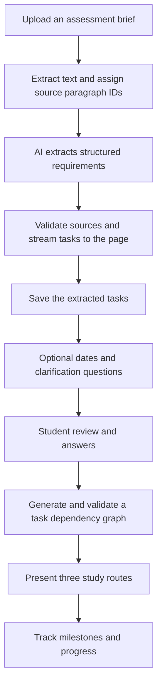

# Ascent — Study Planner

**Turn an assessment brief into a manageable study journey.**

Ascent is a web-based study planner for university students. A student uploads a module description or assessment brief, reviews the tasks identified by AI, answers a few questions about missing details, and chooses a route towards completing their work.

Instead of presenting a long, undifferentiated to-do list, Ascent represents progress as an interactive mountain ascent. Each milestone represents a piece of work, and the summit represents completion of the selected route.

Ascent helps students organise their work. It does not write their assessed submissions.

## Who is it for?

Ascent is intended for university students who want to:

- Understand what a detailed assessment brief actually requires.
- Break a large assignment into smaller, manageable milestones.
- Plan around missing information, optional activities and alternative deadlines.
- See which tasks depend on others and which can proceed independently.
- Track progress without losing sight of completed work.

The project is currently a working prototype for demonstrations and user testing. It is not yet a production student-records or learning-management system.

> **Demo lifecycle:** each browser session has its own workspace. Restarting the application, including an IIS application-pool recycle, clears the demo projects and progress from its configured database. Archived original uploads are retained separately and are not deleted by that database reset. Use a dedicated demo database.

## What students can do

1. **Upload a brief.** Use a supported document or paste its text.
2. **See the requirements appear.** Complete, source-checked tasks are displayed progressively while the AI is still extracting the remaining requirements.
3. **Review the evidence.** Expand “From your brief” to read the original document passages behind a requirement, date or question.
4. **Fill in the gaps.** Answer generated questions using choices, dates or small structured fields. “I don’t know yet” keeps uncertain details unresolved.
5. **Choose a route.** Compare **Scenic Route**, **Steady Climb** and **Direct Ascent**: different groupings of the same validated work.
6. **Follow the mountain.** Complete milestones, keep notes and track progress. Completed milestones remain visible on the route.

Students can also reopen saved expeditions, see their progress, delete an expedition with confirmation, and download its original uploaded document. Duplicate-document detection offers an existing project or a deliberate restart rather than silently creating duplicates.

## How it works



### Document reading and task extraction

A server-side document reader converts the uploaded file into text. Most document formats are handled by the bundled **udoc** command-line reader; plain text formats are read directly. The extracted text is assigned paragraph IDs so the application can trace AI results back to the source.

The AI identifies tasks, deliverables, repeated activities, constraints and missing planning information. It returns structured JSON rather than website HTML. C# checks the returned source references, identifiers, counts and relationships before using them.

Task extraction is model-driven. The application does not maintain a catalogue of assessment-specific task templates or parse each module using its own extraction rules.

### Progressive task display

The task-extraction response is streamed. The server reads complete task objects from the JSON stream, validates their source references, and updates the Blazor page. Incomplete JSON fragments are not shown as tasks.

The complete validated task list is saved **before** optional date extraction or question generation begins. Students can choose **“Continue with these tasks”** once that list is saved, without waiting for the optional stages.

In one live test of the MK644 quiz brief, the first validated task arrived after **6.02 seconds**, with the complete extracted list saved after **16.46 seconds**. These are measurements for that brief, model and server, not a response-time guarantee.

### Questions, dates and uncertainty

The model generates clarification questions from the brief and the extracted requirements. For example, a brief mentioning six workshops may need six titles and dates, rather than one large free-text answer.

Dates are optional enrichment. A verified calendar date can be used in the plan; an uncertain date stays blank. A phrase such as **“w/c 26 October 2026”** remains a week, not an invented exact quiz day. Submission dates and feedback dates are kept distinct, and students can review which submission dates apply to them.

If date extraction or automatic questions fail, the application preserves the validated tasks and provides a review path. It does not guess submission deadlines to make the process continue.

### Routes and dependencies

The AI normally proposes a work graph containing tasks, occurrences and dependencies. The server validates task coverage, applicability, date evidence and graph consistency, including circular dependencies.

The three visual routes are built from that graph. They vary how related work is grouped into checkpoints; they do not silently omit requirements to create a shorter route. Routes may look similar when the work cannot reasonably be grouped differently.

If the proposed graph is unusable or times out, Ascent can build a **labelled basic draft** from the already validated task occurrences. That draft leaves dates and effort unconfirmed and does not invent dependencies. Its order needs review. This fallback cannot recover requirements that were never extracted.

## Technology stack

| Area | Technology |
| --- | --- |
| Application and business logic | C# and ASP.NET Core on .NET 10 |
| User interface | Blazor Interactive Server components, HTML and CSS |
| Interactive map and animation | Browser JavaScript and SVG |
| Database | Microsoft SQL Server through Entity Framework Core 9 |
| AI integration | Server-side `IPlanningAi` abstraction with KoboldCpp and OpenAI APIs provider paths |
| Document extraction | Bundled Windows x64 udoc CLI; direct reading for text files |
| Hosting | ASP.NET Core/Kestrel for development; IIS for the Windows server deployment |

Business logic, document processing, AI requests and validation run on the server. The browser presents the interview and interactive route. React is not required by the current implementation.

KoboldCpp currently uses its native generation/streaming endpoints and a schema-derived grammar. The OpenAI path uses chat completions through the same planning abstraction. The current live validation has used KoboldCpp; the OpenAI path still needs end-to-end provider testing. It is using the new Qwen3-8B LLM model running on an nVidia Graphics card with 11GB VRAM and 544 Tensor Cores.

SQL Server stores workspaces, modules, extracted requirements, routes, milestones, dependencies and document identities, alongside JSON snapshots of the richer planning state.

## Supported documents

The reader accepts:

| Category | Extensions |
| --- | --- |
| Microsoft Word | `.doc`, `.docx`, `.docm` |
| PDF | `.pdf` |
| Rich text and OpenDocument text | `.rtf`, `.odt` |
| Plain text | `.txt`, `.md`, `.csv` |
| Presentations | `.ppt`, `.pptx`, `.odp` |
| Spreadsheets | `.xls`, `.xlsx`, `.ods` |

Uploads are limited to **10 MB** and **60,000 extracted characters**. The full AI request must also fit the loaded model’s context. The application does not silently trim a brief to make it fit.

OCR is not configured. Image-only PDFs and scanned documents may not yield readable text. Reading order and table layout can also differ between formats, so students should review extracted tasks against their original brief.

## Running locally

### Prerequisites

- Windows for the bundled udoc executable.
- The **.NET 10 SDK**.
- **SQL Server** or SQL Server Express LocalDB.
- A running **KoboldCpp** instance with a suitable instruction model loaded, or a separately configured AI provider.

Run the following commands from the repository root in PowerShell. They configure the current shell only.

### 1. Choose a dedicated database

For an installed LocalDB instance:

```powershell
$env:ConnectionStrings__Planning = 'Server=(localdb)\MSSQLLocalDB;Database=AscentDemo;Integrated Security=true;Encrypt=true;TrustServerCertificate=true'
```

For a normal SQL Server instance, replace the server and authentication details with your own. The current demo startup guard permits databases named `AscentDemo` or `Ascent` and clears their demo data on startup. Do not point it at a database containing work you need to retain.

### 2. Configure your AI server

Override the deployment-specific endpoint in the supplied configuration. For KoboldCpp on the same computer:

```powershell
$env:Ai__BaseUrl = 'http://127.0.0.1:5001/v1/'
```

Match the prompt format to the loaded model. The native adapter currently supports `llama3` and `chatml`; this example selects Llama formatting:

```powershell
$env:Ai__KoboldPromptFormat = 'llama3'
```

Configure Kobold’s GPU, context and model settings independently. Changing the application’s context budget does not increase the context actually allocated by Kobold. Use settings appropriate to the model and available hardware.

### 3. Initialise and start the demo

For a new database:

```powershell
.\Run-Demo.ps1 -InitializeDatabase
```

For subsequent runs:

```powershell
.\Run-Demo.ps1
```

Open **http://127.0.0.1:5188/**. The script restores packages, selects the Development environment and starts the website. Stopping and starting it again triggers the demo workspace reset described above.

### Configuration reference

Settings are read from `src/Ascent.Web/appsettings.json`, environment-specific configuration and environment variables.

| Setting | Purpose |
| --- | --- |
| `ConnectionStrings:Planning` | SQL Server connection string |
| `Ai:Provider` | `KoboldCpp` or `OpenAI` |
| `Ai:BaseUrl` | Provider endpoint |
| `Ai:Model` | Provider model identifier; Kobold runs its loaded model |
| `Ai:ApiKey` | Provider credential, kept on the server |
| `Ai:KoboldPromptFormat` | Native Kobold instruction formatting: `llama3` or `chatml` |
| `Ai:MaxContextTokens` | Application-side Kobold context budget |
| `Ai:MaxOutputTokens` | Default response budget; individual stages may specify their own |
| `Ai:TimeoutSeconds` | General AI request timeout; optional dates and routes have additional stage budgets |
| `DocumentExtraction:Executable` | Path to the document-extraction executable |
| `UploadArchive:Path` | Folder used to retain original uploaded files |

Use deployment-specific environment variables or another appropriate secret store for credentials. Do not commit passwords, API keys, uploaded briefs or captured AI requests to GitHub.


## Project structure

```text
Ascent.Demo.sln
Run-Demo.ps1
database.sql
workspace-upgrade.sql
src/
  Ascent.Web/
    Components/           Blazor pages and reusable interface components
    Planning/             Assessment interview, answers, validation and route logic
    Infrastructure/       AI adapters, contracts, SQL storage and upload archive
    tools/udoc/           Document reader, build notes, patches and third-party licences
    wwwroot/              Styles, fonts, JavaScript, SVG artwork and other static assets
```

Useful starting points:

- [Planner page](src/Ascent.Web/Components/Pages/Planner.razor)
- [Assessment interpretation and questions](src/Ascent.Web/Planning/AssessmentInterview.cs)
- [Planning workflow](src/Ascent.Web/Planning/StudyPlanningService.cs)
- [AI client](src/Ascent.Web/Infrastructure/AiClient.cs) and [streaming extraction](src/Ascent.Web/Infrastructure/AiClient.Streaming.cs)
- [Planning contracts](src/Ascent.Web/Planning/Models.cs) and [validation](src/Ascent.Web/Planning/PlanValidator.cs)
- [Route builder](src/Ascent.Web/Planning/RouteBuilder.cs)

## Publishing to IIS

Create a release build:

```powershell
dotnet publish src/Ascent.Web -c Release -o ./publish
```

The Windows server needs the matching ASP.NET Core Hosting Bundle, IIS WebSocket support for the interactive interface, SQL Server access and write access to the upload archive. Configure the site hostname, HTTPS binding and allowed hosts for the deployment. Retain the bundled document-reader files and their licences.

An IIS application-pool recycle restarts the application and therefore resets its demo database workspaces. Persistent production use requires changing that lifecycle, not simply copying the demo to another server.

## Current limitations

- AI extraction can miss or misinterpret requirements. Source checks verify cited evidence, not semantic completeness.
- The basic route fallback depends on a usable extracted task list and leaves task order for review.
- Question quality and response times vary with the document, model, hardware and server load.
- The current prototype has temporary session workspaces, no student accounts and no long-term project retention.
- The bundled udoc build is an alpha reader. OCR and non-Windows deployment are not configured.

The reader’s third-party notices and build information are included in [tools/udoc](src/Ascent.Web/tools/udoc/). This repository does not currently declare a project-wide licence.

